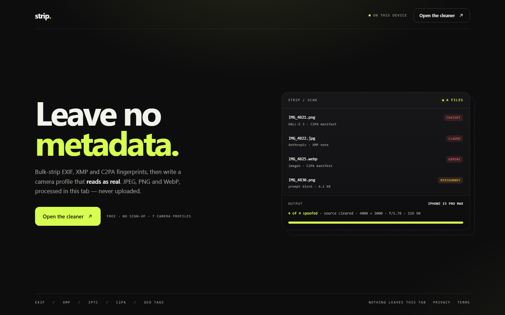
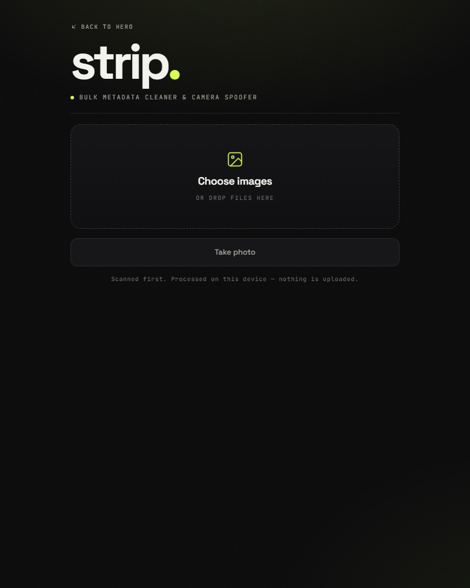

# strip.

**Every photo carries a receipt. strip removes it in bulk, then writes a new one from a camera you choose — entirely in your browser.**

[Open the cleaner](airemover.html) · [Landing page](index.html) · [Terms & privacy](legal.html)

No install. No account. No upload. Three static files and vanilla JavaScript.

---

## What it is

`strip` is a small, offline-first tool for cleaning image metadata. Drop in a folder of images, it scans each one for signs of where it came from, removes everything the file was carrying, and writes a fresh EXIF profile that looks like it came from an iPhone, a Galaxy, a Pixel, a Sony, a Canon, a Nikon, or a Hasselblad.

It was built for people who want their photos to keep their secrets: GPS coordinates, software names, edit history, prompt blocks, and content credentials all disappear from the exported file.

The pixels never leave your machine. Neither does the metadata.

## How it works, in plain terms

1. **Read.** The browser loads each image into memory.
2. **Scan.** It searches the file's metadata text for known marker strings — tool names, C2PA manifests, prompt blocks — and labels what it finds before you process anything.
3. **Re-encode.** The image is drawn onto a canvas. Pixels survive; every metadata container does not. The canvas produces a clean JPEG.
4. **Write.** A new EXIF block is built for the camera profile you picked and attached to the file.
5. **Save.** Files go to a folder you choose, to individual downloads, or into a ZIP built locally.

There is no backend to trust, because there is no backend.

## What it recognizes

Before processing, each file gets a badge naming the signature it matched.

| Signature | Markers it looks for |
|---|---|
| **ChatGPT / DALL·E** | `openai`, `chatgpt`, `gpt-4`, `gpt-3`, `dall-e`, `dall·e` |
| **Claude** | `anthropic`, `claude` |
| **Gemini / Imagen** | `gemini`, `imagen`, `synthid` |
| **Midjourney** | `midjourney` |
| **Stable Diffusion** | `stable diffusion`, `automatic1111`, `comfyui`, `forge`, `invokeai`, `novelai` |
| **Adobe Firefly** | `adobe firefly`, `generative fill` |
| **Flux** | `flux.1`, `black forest labs` |
| **Leonardo** | `leonardo` |
| **Runway** | `runway`, `runwayml` |
| **Ideogram** | `ideogram` |
| **Recraft** | `recraft` |
| **Luma** | `luma`, `dream machine` |
| **Kling** | `kling` |
| **Pika** | `pika` |
| **Playground** | `playground ai` |
| **Generic** | C2PA / JUMBF, `trainedAlgorithmicMedia`, prompt blocks |

**This is text matching, not magic.** A match means a marker was found in the file. No match does not mean the image is camera-originated — plenty of AI images ship with clean metadata and an invisible watermark instead.

## What it does and does not beat

| Layer | Result |
|---|---|
| EXIF, XMP, IPTC, GPS, thumbnails | Removed |
| C2PA / Content Credentials manifests | Removed from the file |
| Embedded prompt and workflow blocks | Removed |
| Filename and software hints | Rewritten |
| Invisible watermarks (SynthID, Meta AI) | **Not touched** — they live in the pixels |
| Statistical and classifier detectors | **Not beaten** — no metadata involved |
| Noise, frequency, and pixel forensics | **Not beaten** |
| C2PA signature validation | **Not forged** — the manifest is gone, not re-signed |
| Reverse image search and hash databases | **Not beaten** |
| Human eyes | **Not beaten** |

So the honest answer to "which models can it bypass": it removes the metadata signature of ChatGPT / DALL·E, Claude, Gemini / Imagen, Midjourney, Stable Diffusion, Firefly, Flux, Leonardo, Runway, Ideogram, Recraft, Luma, Kling, Pika, and Playground. It does not defeat invisible watermarks or detector models. No tool can promise "undetectable", and this one does not.

## Camera profiles

| Profile | Make and model |
|---|---|
| `iphone` | Apple iPhone 15 Pro Max |
| `samsung` | Samsung Galaxy S24 Ultra |
| `pixel` | Google Pixel 8 Pro |
| `sony` | Sony a7R V |
| `canon` | Canon EOS R5 |
| `nikon` | Nikon Z8 |
| `hasselblad` | Hasselblad X2D 100C |

Each profile writes make, model, software, capture date, exposure, aperture, ISO, and pixel dimensions. Some strict readers will show only the make and model.

## Run it

Download or clone the repository, then open `airemover.html` in a browser. That's it.

- **Save to folder** writes straight to a folder you pick. Chrome and Edge on desktop only.
- **Download each file** works everywhere; the browser may ask to allow multiple downloads.
- **Download ZIP** builds the archive locally. Needs the JSZip CDN on first load.

## Screens

## Files

| File | What it is |
|---|---|
| `airemover.html` | The tool |
| `index.html` | Landing hero |
| `legal.html` | Terms and privacy |
| `DESIGN.md` | The visual system, for future edits |
| `AGENTS.md` | Repo note for agents |

## Known quirks

- **Defender or the browser flags the ZIP.** It contains only JPEGs, but archive reputation and SmartScreen do not care. Use **Save to folder** instead, or submit the ZIP to Microsoft as a false positive.
- **Re-encoding is lossy.** Export is JPEG at quality 0.95. Transparency is flattened, animation is lost, and HEIC may fail to decode.
- **Fonts and JSZip load from CDNs.** The tool still processes images without them; only the ZIP export needs the library.
- **No settings are saved.** The camera profile resets on reload.

## Use it on your own work

Only process images you own or have permission to alter. Removing metadata is a privacy feature; using it to fake evidence, commit fraud, or impersonate someone is not. The tool is provided as is, with no guarantee that any platform or person will treat the output as authentic. See [the terms](legal.html#terms).

---

Built as a single-file hack that stayed single-file by design. If it saves you a batch of cleanup, the source is small enough to read in one sitting.
